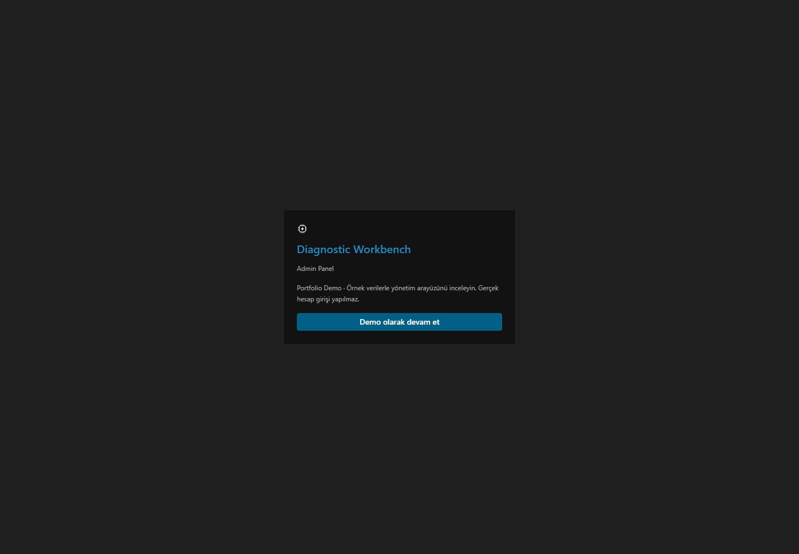
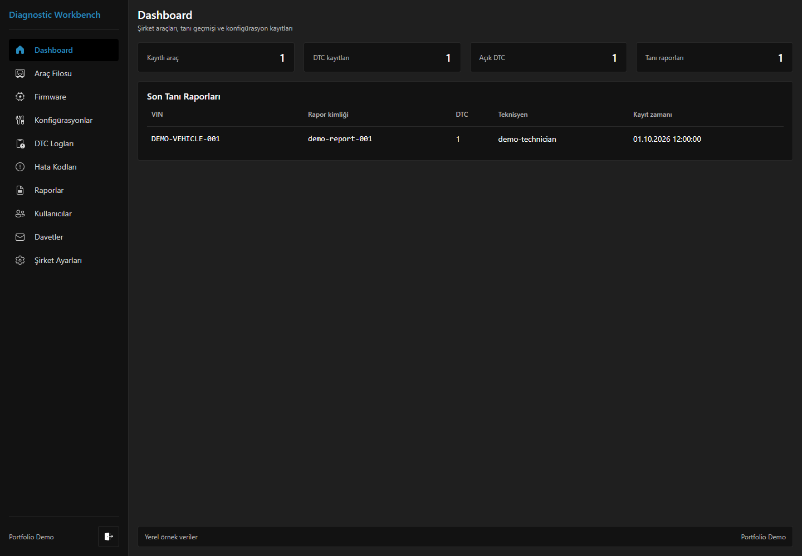
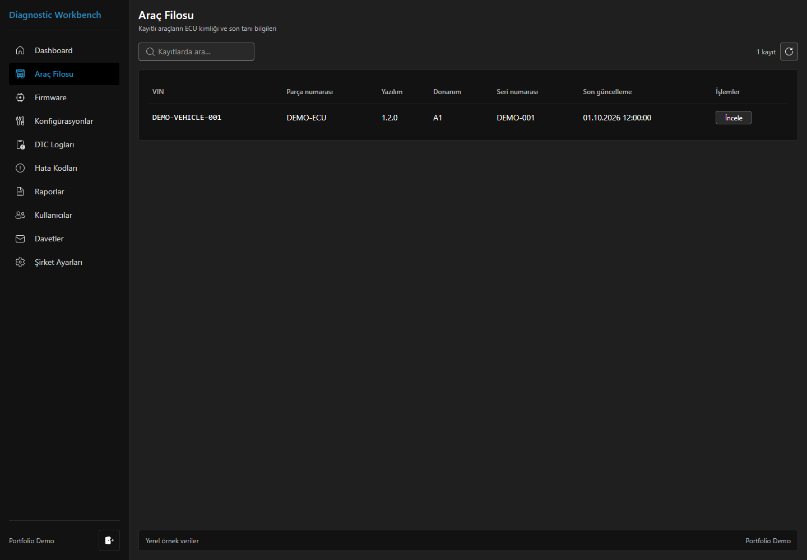
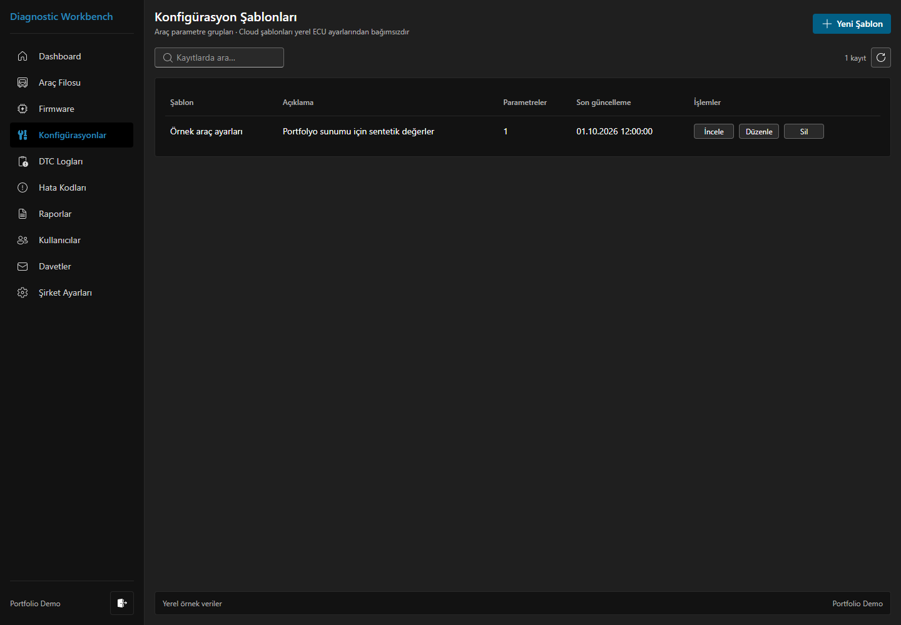
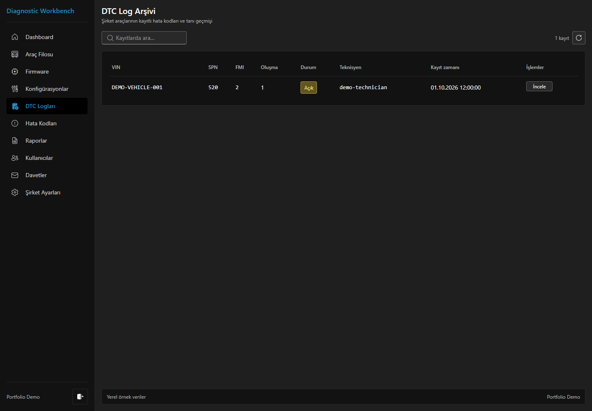
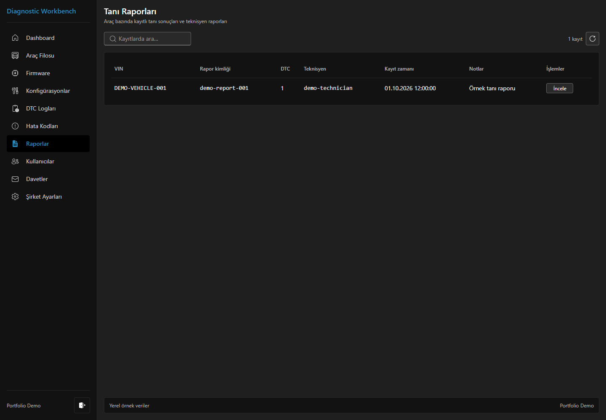
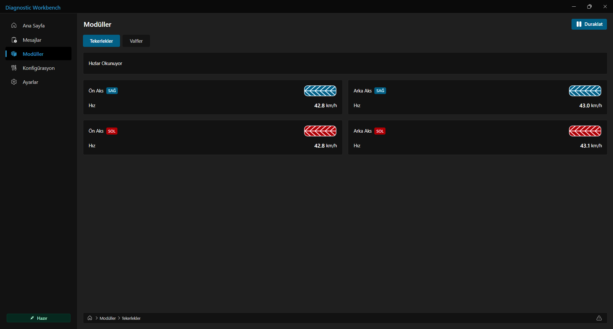
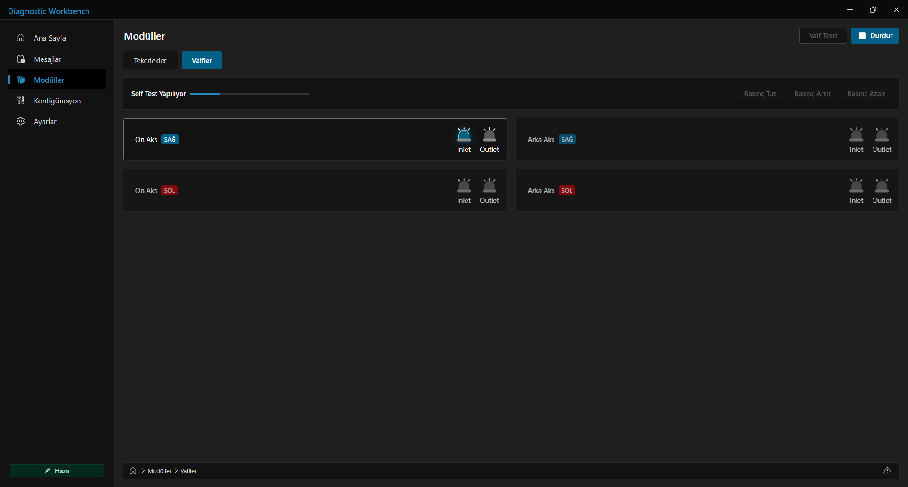

# Diagnostic Workbench

A vehicle diagnostics workbench combining a Windows desktop application, a native C++ diagnostic engine, and a cloud management panel.

**[Explore the web portfolio](https://brknl28.github.io/diagnostic/)** · **[Architecture](docs/architecture.md)**

This public repository hosts the web portfolio and its static GitHub Pages output. It is a project showcase, not the complete product source repository. Desktop, native engine and backend sources remain private.

## What it does

The desktop workspace displays live wheel speeds and vehicle information, reads fault codes, supports configuration read/write operations, and provides valve controls and actuator self-tests. Diagnostic state and telemetry originate in the native C++ engine and reach React through a Node-API addon and Electron IPC.

The web panel presents fleet, configuration, diagnostic logs, reports and company administration. Its public portfolio uses sample fixtures and does not connect to the production Cloud API or accept production account credentials.

The separate cloud application provides Better Auth sessions, company-scoped permissions and explicit device approval. Desktop authentication uses the system browser with OAuth 2.0 Authorization Code + S256 PKCE as a public native client. Windows DPAPI protects persisted desktop credentials. Approved devices can receive signed, time-limited offline diagnostic grants governed by company policy.

## Application views

These are real captures of the running portfolio. All displayed records are portfolio fixtures.

### Portfolio entry

### Management dashboard

### Fleet

### Configuration

### Diagnostic logs and reports

### Windows diagnostic workspace

Existing captures from the packaged Windows application show the local synthetic engine. They do not imply a connected physical vehicle.

[Screenshot provenance](docs/screenshots/README.md)

## Technology and architecture

| Area | Implementation |
| --- | --- |
| Desktop | Electron, React, TypeScript, Fluent UI |
| Native diagnostics | C++, Node-API, CMake |
| Cloud API | Cloudflare Workers, TypeScript |
| Data | Cloudflare D1 |
| Authentication | Better Auth, OAuth 2.0 Authorization Code + S256 PKCE |
| Desktop persistence | Windows DPAPI; tokens remain outside the renderer |
| Offline authorization | Signed Ed25519 grants, device binding, expiry and permission version checks |
| Public portfolio | Vite-generated static assets, GitHub Pages, clean SPA routes |

[Read the architecture overview](docs/architecture.md) for the desktop/cloud boundary and offline authorization limits.

## Development status and limits

The application is under active development and testing. Production-connected Windows QA login, device approval, session refresh and native telemetry have been exercised. Automated checks cover the web panel, Worker API, desktop authorization and native addon lifecycle. The latest source validation passed 19 web, 90 API and 32 desktop tests, plus native smoke checks; these counts describe a development snapshot rather than a release certification.

The current engine produces synthetic diagnostic state. Physical CAN hardware integration, real vehicle diagnostics and firmware flashing are not supported by this implementation. UART, I2C and SPI integrations are not implemented.

Windows QA packages are unsigned pilot artifacts. There is no public desktop release or installer here. A disconnected client cannot receive immediate account/device revocation; an already issued offline grant remains bounded by its signed expiry. Cross-Windows-user DPAPI isolation has not been independently tested in this project.

## Repository contents

- `index.html`, `404.html`, `.nojekyll` and `assets/`: generated portfolio application.
- `README.md`: project overview.
- `docs/`: public architecture notes and application screenshots.

The publication workflow refreshes generated site output while preserving this README and the public documentation. No backend credentials, production data or private application sources belong in this repository. Publication here does not grant an open-source license to the private product.