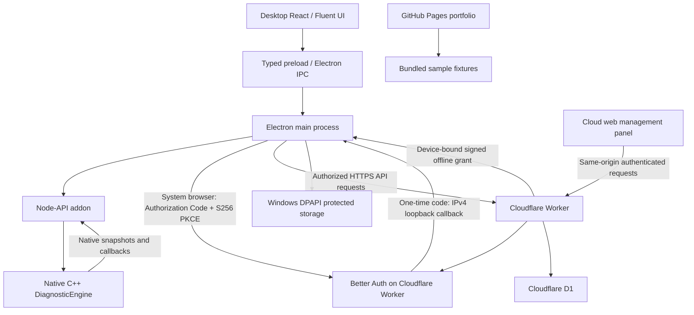

# Architecture

Diagnostic Workbench separates local diagnostic execution from cloud identity and company policy. The public GitHub Pages application is a separate, fixture-backed presentation build.

## Desktop and native engine

React uses a typed preload bridge instead of direct Node.js access. Electron maintains context isolation and a sandboxed renderer. The main process owns cloud authentication and native addon operations; passwords and refresh tokens are not stored in renderer localStorage.

The C++ engine owns synthetic vehicle state, faults, configuration and actuator self-test progression. Worker-thread updates cross the Node-API boundary through thread-safe callbacks and are forwarded over IPC. React displays native state rather than running a second telemetry or actuator sequence.

Local diagnostic execution does not require a cloud request for each action. The desktop authorization layer checks the current online authorization or a valid offline grant before permitted diagnostic operations. Cloud identity and policy do not replace the C++ engine.

## Cloud identity and device approval

Better Auth runs on the existing Cloudflare Worker with D1 persistence. The real web panel and API share an HTTPS origin. Cookie security, CSRF/origin checks, company scoping and role permissions remain enforced.

Desktop login opens the system browser. It uses a public native OAuth client with no client secret, an S256 PKCE challenge, state validation and a one-time loopback callback. The client binds only to IPv4 loopback on an ephemeral local port; callback path, issuer and state are checked. Replayed or invalid callbacks are rejected.

A successful login does not automatically authorize a device. New device registrations begin pending. A company administrator explicitly approves or rejects them in the web panel. Device challenge/proof, membership permission versions and company isolation are checked server-side. Provisioning the fixed public OAuth client is restricted to an explicitly allowlisted, verified operator and is closed after setup.

## Offline authorization and storage

The server signs grants using Ed25519. A grant binds user, company, device public-key identity, permissions, permission version, issuer, audience and validity period. Company policy sets its duration. The desktop trusts a compiled-in public key set selected by `kid`; it does not learn its initial trust from an unauthenticated network response.

Windows DPAPI protects the persisted desktop record under the current Windows user. It is not portable recovery or protection against an already compromised user session. Cross-user DPAPI isolation testing remains outstanding.

Only `iat`/`nbf` checks permit up to five seconds of issuer clock lead. The signed `exp` is not extended; reopening the application does not renew the grant. Clock rollback and signature/device/permission checks remain active.

Online revocation prevents further authorization. While disconnected, immediate revocation cannot be guaranteed: previously issued grants remain valid until their signed expiry unless the local client already knows they are invalid. Key rotation requires shipping old/new public trust overlap before switching the signer; removing a server key cannot erase trust from an offline installed client.

## Public portfolio boundary

GitHub Pages serves the existing `/diagnostic/` build with clean browser routes and a `404.html` SPA recovery mechanism. Portfolio authentication enters a sample-data session; it does not create a production Better Auth session or call the production API.

This repository contains generated static files and deliberately public documentation/screenshots only. It does not contain the private monorepo, desktop binaries, native sources, backend code, signing keys or customer data. The publication workflow preserves `README.md` and `docs/` when replacing generated files.

## Current scope

The native engine is synthetic. Physical CAN/vehicle integration and firmware flashing are not implemented. Windows pilots are unsigned and are not a public production release. The architecture describes implemented components and their boundaries, not a claim of production certification.